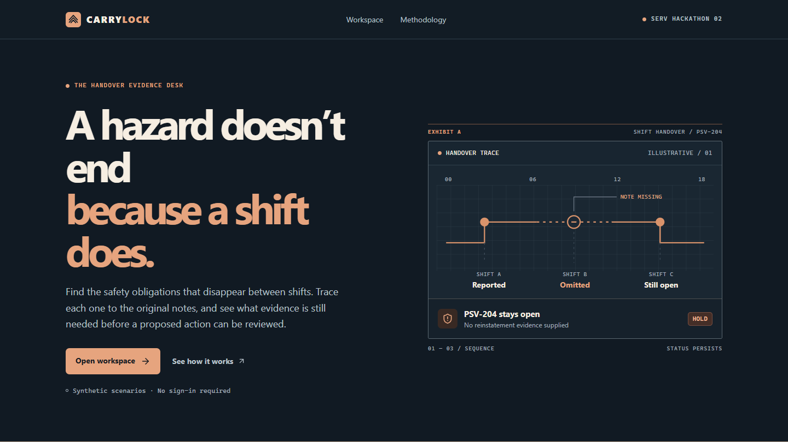

# CARRYLOCK

**A hazard doesn’t end because a shift does.**

CARRYLOCK reconciles safety obligations across industrial shift handovers. It shows where a restriction was mentioned, where it dropped out, which records disagree, and what still blocks a proposed action. Built as a new standalone submission for the SERV Hackathon 02 Open Track.

[Public workspace](https://carrylock.vercel.app/app) · [Methodology](https://carrylock.vercel.app/methodology) · [Evaluation](docs/EVALUATION.md)



## Try it

Open the workspace and choose any of four one-click synthetic scenarios. Click a shift to see which evidence carried forward; expand findings for exact notes or register entries. Download the JSON receipt to inspect the hashes, events, state transitions, evidence gaps, rule codes and advisory verdict.

| Scenario | What the review demonstrates | Advisory |
| --- | --- | --- |
| A · Missing reinstatement | An unresolved relief barrier persists through a three-shift handover | HOLD |
| B · Bypass drops out | An active authoritative register entry survives silence in notes | HOLD |
| C · Permit still suspended | Completed maintenance does not release a suspended permit | HOLD |
| D · Closure supported | A matching release record and named confirmation support closure | NO CONFLICT FOUND |

The four shortcuts replay curated synthetic annotations and make no OpenServ requests. Custom review can call OpenServ when the credential and budget storage are configured and quota is available. All provider failures and incomplete reads remain visible in the receipt. The public demo contains no real plant information or equipment connection.

## How it works

1. The Next.js server validates ordered shifts, known identifiers and aliases, optional register records, and the proposed action.
2. Live extraction sends the shift notes and equipment directory to the OpenServ chat completions endpoint. A versioned prompt and strict JSON schema ask `gpt-5.4-mini` to extract and normalize equivalent observations. The server independently validates the shape, known equipment and permit identity, and verbatim quotation from the source. Coverage gaps and uncertainty are handled conservatively.
3. The deterministic engine keys obligations by equipment, type and permit. It replays shifts oldest first, preserves open obligations through omissions, and requires a matching register record with the configured evidence type, a reference and a named confirmer with the configured role to record closure.
4. The engine compares the proposed action's dependencies with remaining obligations. Active restrictions and conflicts can produce `HOLD`; incomplete evidence can produce `REVIEW_REQUIRED`. `NO_CONFLICT_FOUND` is scoped to the supplied evidence. Qualified personnel retain decision authority.

The engine cannot recover history that was never entered, authenticate register signers, access underlying evidence documents, or distinguish multiple same-category obligations sharing a single equipment/permit key. An incomplete extraction can miss an obligation; results from the synthetic suite do not measure production safety or live model accuracy. This prototype does not certify safety, approve permits, or operate equipment.

## Run locally

Requires Node 22 and npm.

```sh
npm ci
npm run dev
```

To use live extraction, add `SERV_API_KEY` to a Git-ignored `.env.local`. Use synthetic or de-identified notes. Custom notes are sent to OpenServ when live extraction is used; register records and the action are processed locally on the server. The content-addressed cache encrypts extracted quotations and may retain them for an hour. Downloaded receipts contain evidence quotations; share them accordingly.

```sh
npm run lint
npm run typecheck
npm test
npm run build
npm run eval:engine
```

The test suite and `npm run eval:serv` run offline. The `--live` option for synthetic evaluation requires verified provider credits and the locked local ledger. Public paid inference on Vercel requires shared Redis and its own enforced ceiling. See the [SERV recovery report](docs/SERV-RECOVERY.md).

## Usage controls

| Setting | Default / purpose |
| --- | --- |
| `SERV_LIVE_ENABLED` | Set to `1`. Credentials and a working budget ledger are also required. |
| `SERV_DEV_MAX_CALLS` | Local-only lifetime ceiling, including failures and timeouts. |
| `SERV_SHARED_MAX_CALLS` | Explicit lifetime ceiling for the shared Redis ledger, including historical attempts and the five reserved slots. Defaults to zero. |
| `SERV_MAX_SPEND_USD` | $1.00 estimated reservation ceiling; provider charges can differ. |
| `SERV_LIVE_MAX_PER_HOUR` | Three analyses per IP over a rolling hour; shared addresses may share quota. |
| `SERV_FINAL_DEMO_LOCAL` / `SERV_FINAL_DEMO_TOKEN` | Explicit local / trusted server authorization for the five reserved slots. |
| `SERV_BUDGET_USED_CALLS` / `SERV_BUDGET_USED_USD` | Seed for earlier use. Launch defaults count pre-metering attempts conservatively; only reset for a new, independently funded ledger. |
| `SERV_BUDGET_REDIS_URL` / `SERV_BUDGET_REDIS_TOKEN` | Shared HTTPS Redis REST store required on Vercel. Cohosted environments sharing a spend pool must share the same ledger and key. |

Each admitted analysis makes at most one provider call, with low reasoning effort and a timeout. Identical extraction requests are keyed by the input, model, prompt and schema versions; a cache hit returns the original completion provenance and incurs no new call. Budget audit entries record model, usage, errors and cost estimates; they omit raw notes and secrets. Local development uses a locked on-disk ledger, ignored by Git. Hosted custom reviews fail closed when the shared ledger is unavailable. The public synthetic scenarios remain usable without it. The spend cap uses conservative estimates and is not a provider billing guarantee.

## Evaluation and product model

On 16 versioned synthetic verdict cases, full reconciliation matched 16/16 compared with 8/16 for latest notes alone and 10/16 for latest notes plus latest-shift register entries. These evaluations use curated event annotations. On the same 12-case synthetic SERV suite, v2 matched 10/12 and the v3 passage candidate matched 6/12. The selected v2.2 matched 12/12 in each of two fresh authenticated runs with zero unsafe false clears and false holds. One separate targeted v2.2 isolation retest still produced an extra ungrounded event. Validation rejected it and returned REVIEW_REQUIRED. Synthetic benchmarks do not establish accuracy on real industrial records. [Historical evaluation](docs/EVALUATION.md) · [Reproduction commands and failure analysis](docs/SERV-RECOVERY.md#recovery-and-reproduction) · [Saved completions and metrics](docs/serv-recovery-results.json) · [Preview verification](docs/PREVIEW-RELEASE.md).

Revenue model: a site-level subscription for industrial operations teams, based on the number of shift teams and retention needs. Customers would pay for handover evidence reconciliation and audit receipt workflows. A site pilot would require domain validation, verified register integration and operational acceptance before use on real decisions.

Design reference: [Onyx Atelier Pro](https://www.framer.com/marketplace/templates/onyx-atelier-pro/) informs the dark editorial layout, fine lines and restrained copper. The Next.js UI, diagrams and fixtures are original to this project.
